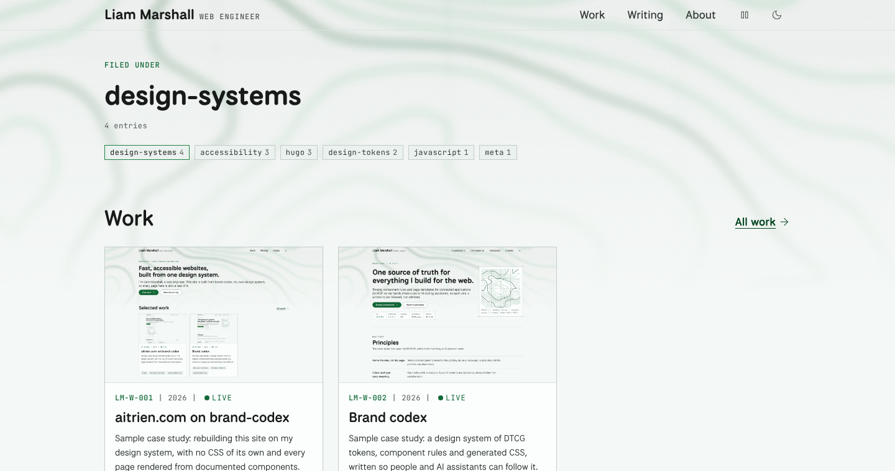

This site was a placeholder: unstyled templates and two sections. The rebuild had one rule. The site has no CSS of its own, so anything it needs and the design system lacks becomes a proposal for the design system instead of a local fix.

## Problem

A portfolio built on its own design system is only a fair test if the site can't cheat. One stray stylesheet and the system stops being the source of truth, and nobody notices until a release changes one place and not the other.

## Constraints

- **One stylesheet, from the module.** It is fingerprinted, carries a subresource integrity hash, and sits one level below the root so its font paths resolve.
- **Documented markup only.** Every element uses a class and structure from a component doc.
- **Works without JavaScript.** Scripts reveal controls; without them, nothing dead appears and the theme follows the system.
- **The build checks the content.** A missing, malformed or reused catalogue number stops the build with the file name.

## Approach

### Module wiring

The site imports brand-codex as a Hugo module, pinned to a tag in `go.mod`. The module mounts its own files, so the import is the whole integration.

```toml {file="hugo.toml"}
[module]
  [[module.imports]]
    path = "github.com/aitrien/brand-codex"

[markup.highlight]
  noClasses = false
```

### Render hooks instead of shortcodes

Markdown stays plain. Hooks turn it into components: fenced code becomes the code block with its copy button, a standalone image becomes a numbered figure, a table becomes a captioned data table, and GitHub-style alerts become callouts.

```go-html-template {file="layouts/_markup/render-heading.html"}
<h{{ .Level }} id="{{ .Anchor }}">{{ .Text }}{{ if eq .Level 2 }} <a class="cx-anchor" href="#{{ .Anchor }}" aria-label="Link to {{ .PlainText }}">#</a>{{ end }}</h{{ .Level }}>
```

### A static tag filter

There is no filtering script. Each tag in the filter is a link to its term page, which lists the matching work and writing with that tag marked current. It works without JavaScript, and every filter state has its own address.



## Outcome

| Check | Result |
|---|---|
| CSS files in the site repository | 0 |
| Lighthouse accessibility, home and a post | 100 and 100 |
| Lighthouse performance on mobile, home and a post | 97 and 97 |
| Requests to other hosts | 0 |
| Page templates | 6 |
{caption="Launch checks | Production build, measured before launch"}

## What I'd change

I would have prototyped the backdrop before the first release. It replaced the plate on the home page, moved the header controls to pills, and needed a new contrast check for text on the frost, all in brand-codex rather than here, which is exactly what the one rule is for.
