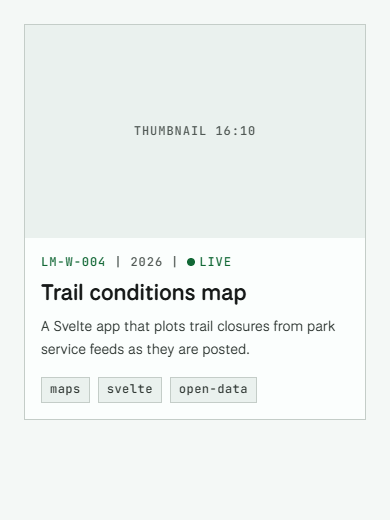
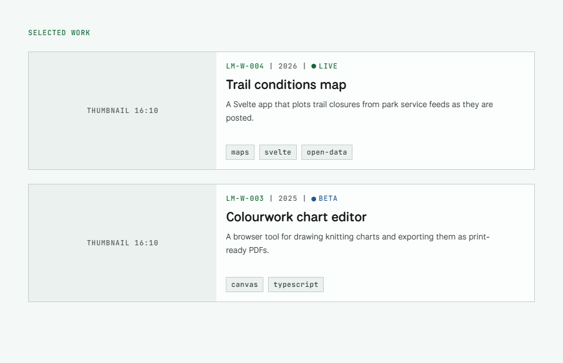

[MotifSpec](/work/motifspec/) is my design system. This project is everything around it: how a change to the specification reaches every project that uses it, and how someone who has never opened the repository can build with it from one prompt and still meet its standards.

## Problem

The aim was a system where UX designers work on the design specifications and make sure everything passes accessibility and other standards, while anyone in the development or marketing teams can connect to the hosted specifications and rapidly prototype compliant designs with a single prompt.

Before this, a front-end developer building a prototype with an AI assistant worked from design documents uploaded into the chat. There was no standardised way to check the result against them.

I also wanted the method to get better the more it's used. Each gap someone finds becomes a rule or a check in the specification, and the next release gives it to everyone who connects.

## Constraints

- **One source.** Designers edit one repository. Every way of using it is published from the same tagged commit: the Hugo module, the npm package, the MCP server and the showcase.
- **Standards checked by a machine.** Contrast is measured in both themes on every build, and the same checker runs in continuous integration and behind the MCP server, so a person, a pipeline and an assistant can't disagree about what is allowed.
- **No stored secrets.** Publishing and deploying prove their identity with short-lived tokens from GitHub, not keys kept in the repository.
- **Nothing to install to prompt.** Anyone with an AI assistant should be able to use the specification by adding one address.

## Approach

### One specification

The specification is three kinds of file. Tokens hold values with a usage rule in their description, and every foreground colour declares the surfaces it may sit on and the contrast it needs there. Component docs hold the markup to copy, what to do and not do, and the accessibility notes. Hugo partials render each component from its doc, so a site no longer keeps copies of the markup that can drift.


### Releasing on merge

A designer's change goes in as a pull request with a version bump and a changelog entry. Continuous integration validates every token, measures all 95 contrast pairs in light and dark, audits the templates and the markup in the docs, tests the MCP server and checks the npm package has every file it promises. It also says what merging will release, and fails if that release is invalid.

Merging is the release. A workflow tags the exact commit that passed, publishes the changelog entry as the release notes, then fans out: npm with provenance, the MCP server on AWS, and the showcase on GitHub Pages. Each step checks its own result, so the MCP step calls the live server and confirms it reports the new version.

### One set of rules in three places

The rule checker started as an audit inside the site. It now lives in MotifSpec and runs in three places: on MotifSpec's own templates and docs, in each project's CI from the version that project pins, and as the MCP server's `check` tool. It fails on raw colours and sizes, style attributes, primitive or deprecated tokens, and any class or icon the specification doesn't define.

### A hosted MCP server

The server is how the specification reaches people outside the repository. It runs on AWS Lambda behind a custom domain, reads only the files of the release it was deployed from, needs no sign-in, and is rate-limited.

| Tool | What an assistant gets |
|---|---|
| `get_rules` | The rules for using MotifSpec, and what the checker enforces |
| `find_tokens` | Tokens matching a query, with their usage rule, light and dark values and allowed surfaces |
| `get_component` | A component's doc, with its Hugo partial and Markdown form |
| `get_doc` | The Hugo guide or the page templates |
| `check` | The checker's problems in a piece of markup, Markdown or CSS |
{caption="MCP tools | Read-only, answered from the release's own files"}

The server also tells an assistant how to work: read the rules first, build from the components, and run `check` before handing anything over. Connecting takes one address. In a project it is a small file, so every assistant that opens the repository finds it:

```json {file=".mcp.json"}
{
  "mcpServers": {
    "motifspec": {
      "type": "http",
      "url": "https://mcp.motifspec.com/mcp"
    }
  }
}
```

## Outcome

With the server added as a connector, a new chat and the prompt "can you mockup a horizontal project card using MotifSpec styles" produced the cards in Plate 3, with their rest, hover and focus states. The same chat also produced the stacked layout in Plate 4.



{width="prose"}

| Channel | Who it's for | How it's checked |
|---|---|---|
| Hugo module | Sites built with Hugo, such as this one | Its templates pass the checker in CI |
| npm package | Any other project, at an exact version | CI proves it has every file it promises |
| MCP server | Anyone prompting an AI assistant | Tested in CI, then the live server is asked its version |
| Showcase | People reading the specification | The live page must name its version |
{caption="Published from one tag | Every release reaches all four"}

The same response also produced a list of cards, and it shows where the method is still weak. The second card has a "Beta" status in blue. MotifSpec has three statuses, live, building and archived, and the component doc the assistant could read says so. The specification was available; nothing made the assistant follow it.



## What I'd change

The MCP server serves the latest release, while a project can pin an older one. If the two differ, an assistant can be offered something the project doesn't have yet. The project's own checker catches that, but a versioned address for each release would stop it happening in the first place.

Three problems I hit came from how the pieces were joined rather than from the code in them. A release was tagged a minute before its changes were merged, which is why releasing is now automatic. Renaming the repository changed the identity GitHub presents to AWS, so the deploy role had to match the new form. And publishing the showcase with GitHub Pages took over the path this site loaded its stylesheet from. Each one is now covered by a check or a comment, and I'd look for that kind of coupling earlier next time.

The Beta status is the next thing to fix, in two parts. First, make checking part of every answer instead of an instruction the assistant can skip: a prototyping prompt on the server that ends by running `check` and shows its result next to the mockup, so whoever reviews it sees any problems straight away. Second, teach the checker the allowed values as well as the allowed classes, so a status, or any other fixed set, that the specification doesn't list fails like an unknown class does.

I'd also make it cheaper to use. By a rough count, at about four characters to a token, a card mockup through the server takes 3,000 to 5,000 tokens of lookups, against about 47,000 to upload the same documents into a chat. Two costs hide inside that number. Every tool call makes the assistant read the whole conversation again before its next step, so four calls process it several times over; prompt caching absorbs most of that, but not all. And a broad token search is the most expensive answer the server gives: `find_tokens` for "surface" returns about 2,500 tokens, more than any single component doc.

The fixes are small. `find_tokens` could return names and usage rules, and leave values until they're asked for. The prototyping prompt from the Beta fix could bundle the rules, a component and `check` into one request instead of four. And in a chat, where a preview can't load the hosted stylesheet and the assistant writes the CSS out again from the tokens, the server could hand over just the CSS a component needs, to copy instead of rewrite.

The next test is the one the system was built for: handing the connector to someone who has never opened the repository, and seeing how far one prompt gets them.

## Credits

The hero is drawn with [Hairline](https://hairline.lucasmarkes.com/) by Lucas Marques, released under the MIT licence, in MotifSpec's colours.
