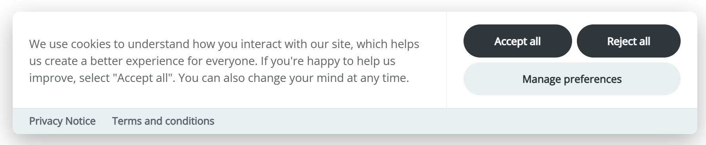

Ara's website measured itself with several tools, each added for a good reason at a different time. What it lacked was one place that decided whether any of them were allowed to run. I built that layer: a consent banner that knows where the visitor is, tells every tool what it may do, and never lets a failure turn into tracking without permission.

## Problem

The measurement stack had grown one tool at a time. Each answered a different question:

- **Google Analytics 4**, through Google Tag Manager: where visitors go and what they do.
- **Microsoft Clarity**: how they behave on the page, through heatmaps, session recordings and scroll depth.
- **Semrush**: how people find the site through search.
- **Monsido**, now Acquia Web Governance: whether the pages themselves are accessible and in good order.

Google's June 2026 change made consent mode the only control over what Google Ads could take from GA4. Without a granted `ad_storage` signal, only anonymous pings are sent. The site needed to send that signal correctly, and the same decision had to govern every other tool too.

## Constraints

- **Two audiences under different rules.** Most visitors are in New Zealand, but Ara also recruits international students, who visit from countries with stricter consent laws.
- **It had to live in the CMS.** The banner and its configuration run as an inline script in the site's templates, with no new service behind it.
- **No new vendors.** No paid consent platform, and no third-party lookup to find out where a visitor is.
- **Failure must never mean tracking.** If any part of the system breaks, the visitor gets less tracking, not more.
- **An honest choice.** Accepting and rejecting take the same effort and look the same.

## Approach

### An open-source consent library

The banner is built on Orest Bida's CookieConsent library, version 3.1.0. It already handles categories, per-service switches and blocked scripts, so my work went into the configuration and the regional logic rather than rebuilding a dialog.

### Region from the edge

The site is served through Cloudflare, which exposes a small diagnostic endpoint on the site's own domain. Its `loc` field is the country Cloudflare resolved from the visitor's IP address.

```console
$ curl -s https://ara.ac.nz/cdn-cgi/trace | grep loc
loc=NZ
```

Because the request goes to Ara's own domain, no location service outside the site learns anything about the visitor.

### Two experiences

Visitors in New Zealand see a short notice with an acknowledge button and a way to opt out. Consent is granted by default, which keeps the data Ara relies on for decisions while still telling people what is collected.

Everyone else gets a full consent gate. Nothing in the analytics group runs until the visitor chooses.



### Blocked until allowed

Every analytics script ships with `type="text/plain"`, so the browser treats it as text and doesn't run it. The library switches each one on only when its category or service is allowed. Choices are passed to Tag Manager through `gtag` consent updates, so GA4 and anything else in the container follow the same decision.

### Failing in the safe direction

Each part of the system that can fail falls back to the stricter outcome:

| Situation | What the visitor sees | What runs |
|---|---|---|
| Visitor in New Zealand | Notice with acknowledge and opt-out | Analytics, unless they opt out |
| Visitor outside New Zealand | Full consent gate | Nothing until they choose |
| Region lookup fails or returns nothing | Full consent gate | Nothing until they choose |
| Consent library fails to load | No banner | Nothing: blocked scripts stay blocked |
{caption="Consent by situation | Every failure falls back to the stricter outcome"}

A visitor on a VPN gets whichever region their connection resolves to. When that's outside New Zealand, they simply see the stricter version.

## Outcome

The consent layer went live on ara.ac.nz in my last week at Ara, so I have no consent-rate figures to report. What changed is structural:

| Tool | Before | After |
|---|---|---|
| Google Tag Manager and GA4 | Loaded on every visit | Load after consent; consent mode signals sent with every choice |
| Microsoft Clarity | Loaded on every visit | Loads only after consent |
| Acquia Web Governance | Loaded on every visit | Loads only after consent |
| Consent decision | No single place | One configuration, two regional experiences |
{caption="Analytics on ara.ac.nz | Before and after the consent layer"}

## What I'd change

I would self-host the library. Loading it from a public CDN puts one third-party request in front of every page. The design means an outage there fails safe, but it would leave visitors with no banner and Ara with no data until it recovered.

I would also build the consent-rate reporting before launch rather than after it. Knowing how many visitors outside New Zealand accept, reject or leave the choice open is how you tell whether the wording and layout work.
