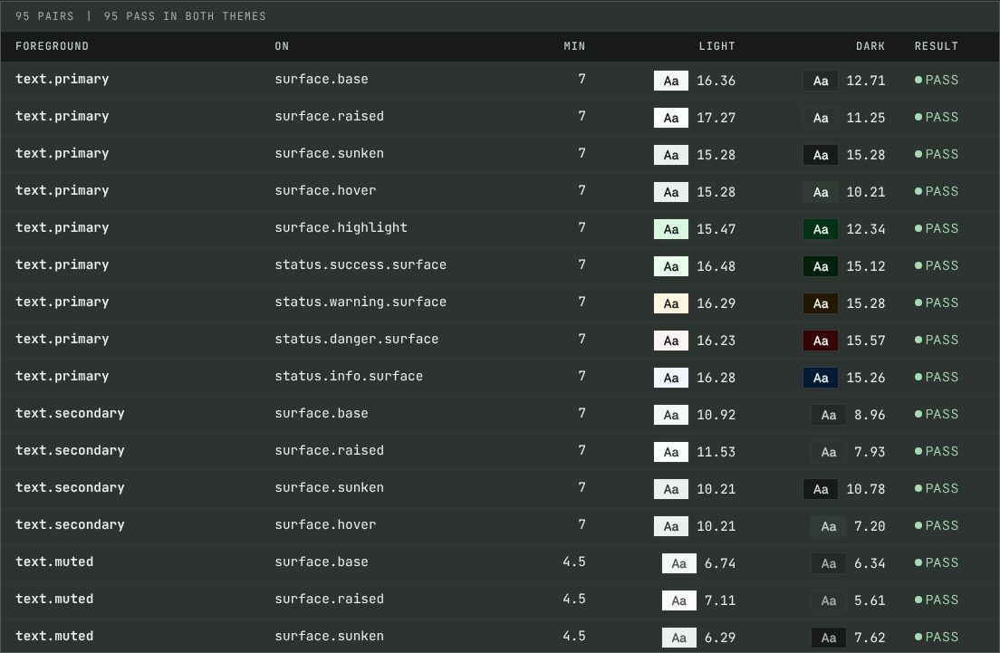

MotifSpec is the one place my projects get their colours, type, spacing and components from. It was called brand-codex until version 1.10.0. It ships as a Hugo module and an npm-style package, and every rule in it is written as an instruction, because an AI coding assistant reads it as often as I do.

## Problem

Each new project started by copying CSS from the last one. Values drifted, dark mode was an afterthought, and contrast was checked by eye, if at all. When I asked an assistant to add a page, it invented new colours because nothing told it which ones existed or what they were for.

## Constraints

- **No runtime dependencies.** The build is plain Node, so it runs anywhere and nothing has to be updated to keep it working.
- **Both themes are first class.** Every colour has a light and a dark value, and both are measured.
- **Pinnable releases.** Sites import a tagged version and only change when I move the pin.
- **Readable by machines.** Every semantic token carries a usage rule in its description, not just a value.

## Approach

### Tokens with usage rules

Tokens follow the Design Tokens Community Group format in two tiers. Primitives hold raw values; semantic tokens alias them and say when to use them. A site only ever sees the semantic tier.

```json {file="tokens/color.json"}
"accent": {
  "border": {
    "$value": "{primitive.color.sap.600}",
    "$type": "color",
    "$description": "Accent rules that mark the active item. Not for static decoration."
  }
}
```

### Contrast as a build step

Foreground tokens declare which surfaces they sit on and the ratio they need: seven for reading text, four and a half for labels, three for controls and graphics. The validator measures every pair in both themes, and the build stops if one fails.



### Hugo as the delivery format

The repository is also a Hugo module. Its own configuration mounts the generated files and the fonts, so a site needs one import line and a pinned version. Page templates and render hooks live in the site; the rules for what they output live here.

## Outcome

Version 1.7.0 is the first tagged release, and this site is the first consumer.

| Measure | Value |
|---|---|
| Tokens | 283 |
| Semantic tokens | 145 |
| Contrast pairs, each checked in two themes | 95 |
| Component docs | 19 |
| Icons in the sprite | 16 |
| Font payload in KB | 88.0 |
| Releases from 1.0.0 to 1.7.0 | 11 |
{caption="MotifSpec 1.7.0, then called brand-codex | From npm run build"}

## What I'd change

I would start with deprecation rules on day one. Removing two unused tokens forced a choice between a major version, which changes the module path, and keeping them a little longer. The second option was right, and now the validator enforces it.
