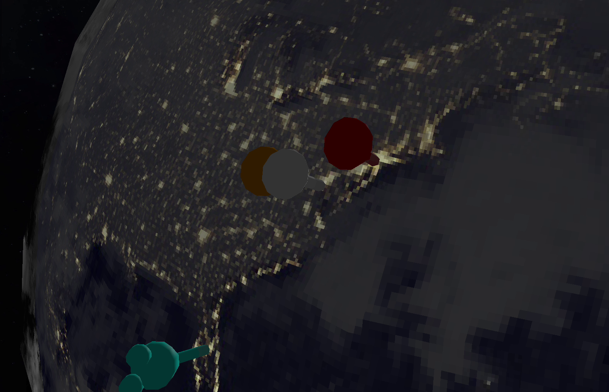
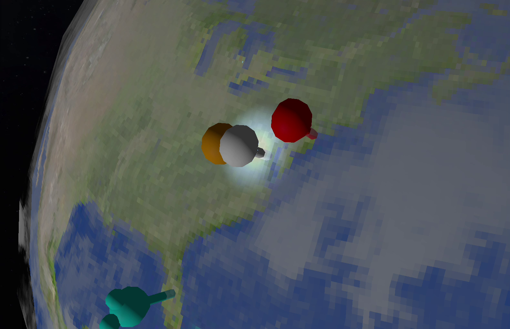

Pinned planet is a globe of the places my partner and I have explored together. Each pin opens the photos from that trip, and the Earth beneath it is lit by the sun as it would be on any day and time you choose. You can [explore it live](https://pinned-planet.onrender.com/).

It was also my first project built with an AI coding agent. I wanted to learn the techniques that were emerging for directing one, steering documents and spec-driven development, on something I cared about.

## Problem

I wanted one place that showed where my partner and I had explored together: a globe we could turn, with each trip pinned where it happened and its photos a click away.

## Constraints

- **No back end.** It's a personal project, so the pins and photos ship with the site. A script builds a manifest of each place's photos, and the app reads it at runtime.
- **Directing, not typing.** I set the direction with steering documents and specs, and reviewed what the agent built against them.
- **Ordinary hardware.** It has to run in a browser on a normal laptop, so the detailed textures can't be the default.

## Approach

I pushed for the globe to be as true to the real thing as I could get it: the tilt of Earth's axis through the seasons, a soft line between day and night, a separate map of city lights for the night side, and highlights that only catch the water.

### Lit by the real sun

The day-of-year slider moves the sun the way the seasons do. Earth's axis is tilted by about 23.5 degrees, and the sun's height above the equator follows a sine curve through the year, crossing zero at the March equinox, around day 81:

```js {file="components/Earth/EarthScene.jsx"}
const axialTilt = 23.5 * (Math.PI / 180);
const declination = axialTilt * Math.sin((2 * Math.PI * (day - 81)) / 365);
```

The time-of-day slider then turns the sun around the globe at that height. Set it to late December and the far south stays in daylight while the north gets short days.

### Day and night in one shader

A custom GLSL shader decides, for every point on the surface, how much sunlight it gets. It blends from a daytime map to a map of city lights across a narrow band at the terminator, so dusk is a soft edge rather than a hard line:

```glsl {file="components/Earth/dayNightShader.js"}
float dayNightMix = smoothstep(-0.1, 0.1, lightIntensity);
vec4 finalColor = mix(nightColor, dayColor, dayNightMix);
```

On the day side, the same shader adds a highlight where sunlight reflects off the surface. In HD mode, a specular map, white for sea and black for land, with the clouds included, limits that highlight to open water, so it glints off the oceans but not the continents or the cloud tops.



### Live clouds

The cloud layer comes from Matt Eason's live cloud maps, which are rebuilt from EUMETSAT satellite imagery every three hours. The globe fetches the latest map each time it loads, so the clouds you see are the real ones from a few hours ago. If the maps can't be reached, the globe falls back to a plain atmosphere rather than failing to load.

### Flying to a pin

Selecting a pin flies the camera to it along a curved path with an ease in and out, then opens the photos as a reel of polaroids beside the place's notes. Return to Globe flies back along a path to the exact view you left.


### Weather at each pin

Each pin shows a weather condition, such as rain, or a thunderstorm with flashes of lightning around the pin, alongside a temperature and humidity reading. For now these are placeholders: the condition is picked at random and the readings are fixed. I added them because I could see the globe becoming a way to check the weather at each place you've pinned, or even a weather tracker in its own right.



### Loading in stages

A loading manager brings the scene up in a fixed order: the Earth's textures, then the shader, the atmosphere and the starfield. The order is there so the scene never draws before its textures have arrived. The globe starts with small textures, and an HD mode swaps in 8K maps when you ask for them.

## Outcome

Pinned planet is live, with six of our trips pinned.

| Measure | Value |
|---|---|
| Places pinned | 6 |
| Photos | 34 |
| Source files | 20 |
| Lines of JavaScript and JSX | about 5,000 |
| Default daytime map, pixels wide | 512 |
| HD daytime map, pixels wide | 8,192 |
{caption="Pinned planet | From the repository"}

## What I'd change

I want to come back and refactor it so anyone can pin their own places. Today the pins are written into the code, and a pin added in the app disappears when the page reloads. Opening it up means accounts, storage for pins and photos, and an API between them: the step from a personal project to a full-stack product.

With pins that belong to anyone, the weather placeholders can become real: a forecast for each place from a weather service, driving the effects on the globe.

The cloud panel needs fixing too. It says the layer auto-updates every three hours, a detail the agent invented: the clouds have always come from the live source, but the app fetches them once per visit. I noticed while building it and left it. This was early in pushing an agent that far, credits were limited, and fixing one bug often turned up more, so a wrong label wasn't worth the risk of breaking something else.

That's my main lesson from working with an agent. It built features quickly, but it could state things the code didn't do, and each fix had a cost. Next time each spec will include the checks that prove a feature works, and I'll review against those checks rather than against how the feature looks.

Finally, the globe is a canvas driven by the mouse. The list of pins should be a complete keyboard and screen-reader route to every place and its photos.

## Credits

- **Clouds and specular map:** [Live cloud maps](https://github.com/matteason/live-cloud-maps) by Matt Eason. Contains modified EUMETSAT data.
- **Earth and star maps:** [Solar System Scope](https://www.solarsystemscope.com/textures/), under the Creative Commons Attribution 4.0 licence.
