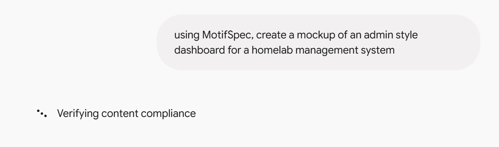

[MotifSpec](/work/motifspec/) has a hosted MCP server at `https://mcp.motifspec.com/mcp`, so any AI assistant can read the design system's rules and check its own markup against them. It's read-only and needs no sign-in. I built and tested it with Claude, where it worked the first time. When I added it to Gemini, it failed.

## Adding it to each

In Claude, the server is a custom connector: paste the address and it's available in a new chat. In a code project, Claude Code reads it from a small file in the repository:

```json {file=".mcp.json"}
{
  "mcpServers": {
    "motifspec": {
      "type": "http",
      "url": "https://mcp.motifspec.com/mcp"
    }
  }
}
```

In the Gemini app it's a custom connected app: choose Customize, then Connectors, then **+ Custom**, and paste the same address. It needed nothing under Additional settings. Google's help page lists a few conditions on the account: you have to be 18 or over, in the US, signed in with a personal Google Account, and have Keep Activity turned on. Gemini CLI uses a settings file like Claude Code's, but with one trap: there, `url` means the older SSE transport, and a Streamable HTTP server like this one needs `httpUrl` instead.

## Where Gemini stopped

Gemini's only message was "We had trouble connecting to this server. Contact the server provider for help." I was the server provider, so I sent the server the kinds of requests a stricter client might, and three of them failed:

| Request | Before | After |
|---|---|---|
| A GET, which some clients send after connecting to open a stream for live updates | Held open until the Lambda timed out after 10 seconds, then an error | Refused at once: the server has no updates to send |
| A request that accepts only JSON, anything, or doesn't say | Refused with 406 Not Acceptable | Answered in JSON, as every other request is |
| A browser's CORS check before calling from another site | Refused | Allowed: the server is read-only and has no sign-in |
{caption="What changed in MotifSpec 1.17.1 | The same requests, before and after"}

None of these stopped Claude. After the fix shipped in [MotifSpec 1.17.1](https://github.com/Aitrien/motifspec/blob/main/CHANGELOG.md), Gemini connected. I can't say which of the three it needed, because I fixed them together.

## The same kind of request, two results

With both connected, I asked each for something MotifSpec wasn't designed for: an admin dashboard for a homelab.


{width="prose"}

Gemini built a case study. "Homelab cluster console" has my name as the wordmark, the site's Work, Writing and About navigation, an "All work" link, a catalogue number (LM-W-009) with a filing date and a role, a numbered plate for the network diagram, and a table of contents. Every part follows the specification, and almost none of them belongs on a dashboard.


Claude came closer to a dashboard: a "Homelab control panel" header with its own navigation, stat tiles, and a card for each node with usage bars. It still borrowed the portfolio's vocabulary, with an accession-style label for the rack, catalogue numbers for each node, and heading anchors on the sections.


Neither result is wrong, given what the assistants had to work with. MotifSpec's components are the ones a portfolio needs: case studies, posts, cards, figures and tables. There is no stat tile, meter or status list, so one assistant used what was there and the other built what was missing. The specification can hold any site to its rules, but it can only shape the kinds of pages it has components for.

## What I'd take from it

The first request in the table is the one I'd watch for. The MCP spec lets a server without live updates refuse that GET outright, but the library I used kept the request open instead, and nothing in my tests sent one. Claude worked regardless; Gemini didn't, and its error message couldn't say why. Testing a server only against the client you built it with tests that client's patience, not the server. Each request in the table is now a test, so the server is held to the stricter behaviour from here on. The dashboards point to the next release: components for the pages people will actually ask for, so the rules have something to work with beyond a portfolio.
